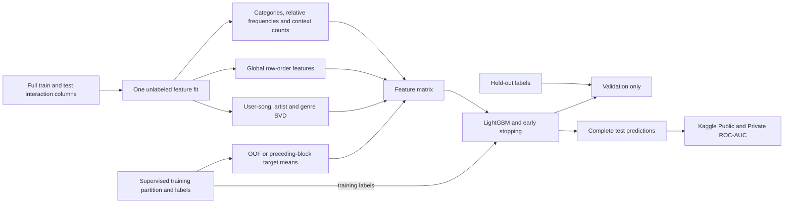
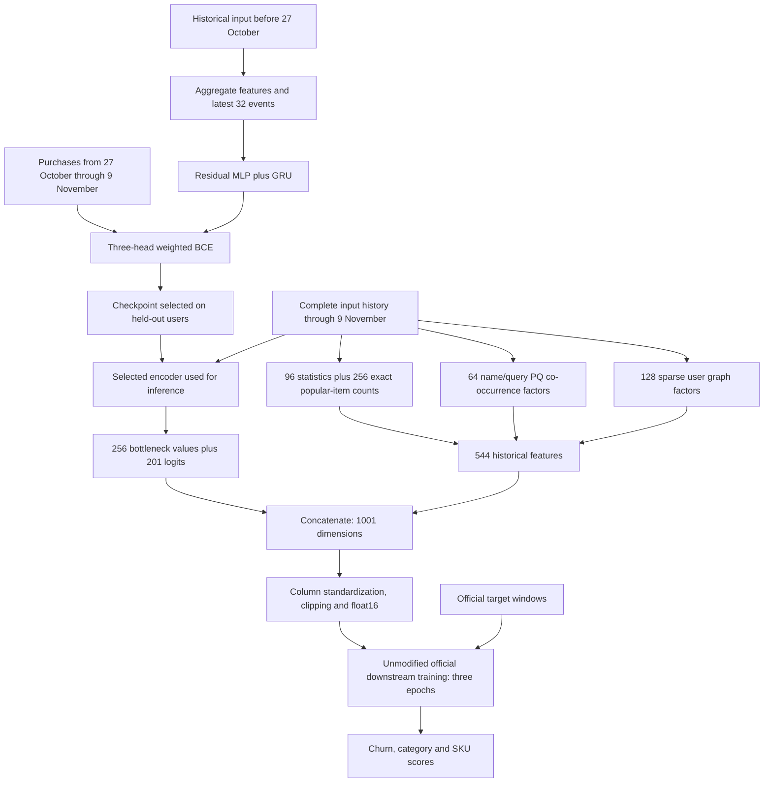

# Advanced recommendation experiments

This document supplies methodology, architecture figures, and experiment material for the English course report. The project's contribution is the implemented combination and controlled evaluation of established components.

## Evaluation targets

The requested targets are KKBox Public and Private ROC-AUC ≥ 0.7050, Synerise churn AUROC ≥ 0.7500, and both propensity scores ≥ 0.8150. They are acceptance targets, not predicted outcomes. The propensity score is `0.8 × AUROC + 0.1 × Diversity + 0.1 × Novelty`; it must not be reported as plain AUROC.

The preceding recommended models achieved 0.67905/0.68125 on KKBox and 0.7286/0.7961/0.7881 on the three Synerise tasks. Historical results remain in their original records. New formal results will be inserted only after the platform or unmodified evaluator returns them.

## KKBox: separating unlabeled structure from supervised statistics

The transductive branch fits categorical vocabularies, relative frequencies, context/preference probabilities, and sparse interaction factors on the complete train-plus-test interaction universe. The CSV reader excludes the label column from this branch. The same fitted state is used for model training, validation, inference, and optional supervised refitting.

Six file-order proxies describe global position, previous and next user-event row gaps, forward and reverse user counts, and a song's relative frequency in the final 30% of rows. Row distance is not elapsed time. Next-event and reverse-count features use future **unlabeled** input within a batch prediction setting; this experiment does not establish suitability for causal online serving.

Five smoothed label features cover user, song, artist, user/source-system-tab, and user/source-type. Random validation uses five-fold out-of-fold values. Row-order training uses preceding blocks only, with a fixed 0.5 prior before any previous labels exist. External validation and test rows query statistics fitted on the corresponding supervised training partition.

The first ablation uses the final 500,000 training rows, a fixed 400,000/100,000 row-order split, and seed 42. It compares training-only statistics, global unlabeled statistics, row-order features, graph factors, target encoding, preferences, larger trees, and a separate relative-frequency variant. These share validation row identities. Their AUC values are not directly comparable with the earlier random holdout or with a different full-data holdout.

The transductive graph directly addresses a limitation of the previous training-only graph: training interactions were present during graph fitting while held-out interactions were absent. An absent edge between known nodes does not imply a zero reconstructed inner product, but the structural mismatch can still affect the feature distribution. A negative result from that earlier configuration is not a verdict on all collaborative methods.

## Synerise: historical pseudo-target pretraining

The pseudo-input ends at `2022-10-26 23:59:59.999999999 UTC`; the pseudo-target contains purchases from `2022-10-27 00:00:00` through `2022-11-09 23:59:59`. Both come exclusively from `input/`. Product and category prediction classes are selected from pseudo-input purchases, and aggregate columns remain fixed when the encoder later processes the complete input history.

The encoder trains on 900,000 users and selects its checkpoint on 100,000 held-out users. Feature normalization and loss weights use training users only. Churn loss applies only to users who purchased in the pseudo-input. Its positive weight is the training-eligible negative/positive ratio, clipped to `[0.02, 50]`; propensity positive weights are clipped to `[1, 50]`.

Pretraining stopped after four epochs and selected epoch 2 (zero-based index 1), with internal validation weighted BCE 0.13959244. This loss is not an official task score. Of the history-selected 100 SKU classes, 19 have no positive training users and 34 have no positive validation users in the pseudo-target. The vocabulary is retained rather than reselected using future purchases. These history-selected classes can differ from the official downstream class lists; their logits are representation features, not direct official predictions. The final 457-dimensional encoder output covers all one million users.

The 544-dimensional historical representation contains 96 event, price-bucket, and rhythm statistics; 256 exact popular-SKU/category decay counts; separate 32-dimensional name and query pools; and 128 row-normalized sparse graph factors. Average purchase interval is span divided by `count−1` for at least two purchases. Price values are ordinal bucket indices, not money. PQ factors describe position/code co-occurrences and do not recover an unavailable original PQ codebook.

The requested block sizes sum to 1001 dimensions. Adding the separately requested two 64-bin long-tail blocks produces 1129 dimensions; this is an explicit optional variant. Column clipping and float16 rounding do not preserve exact zero means or unit variances.

## Controlled downstream comparison

The formal Synerise comparison uses standardized 544-dimensional history features and standardized 1001-dimensional combined features. All one million client IDs match, all output entries are finite, and the shared 544 columns are exactly equal after float16 standardization. Thus the incremental comparison adds only the pretrained block. Each representation is evaluated on all three tasks using the same official commit, dependency versions, seeds, target cache, and three-epoch protocol.

This isolates the pretrained block within the new feature family. A comparison against the earlier 673-dimensional representation additionally changes the historical feature design; it cannot attribute all differences to pretraining, PQ pooling, or graph factors individually. Results are from one seed and do not establish statistical significance.

## Runtime evidence and limitations

Pseudo-window preparation took 627.634 seconds, encoder training 147.545 seconds, and full-user extraction 35.761 seconds, measured around the actual subprocesses. The historical 544-dimensional build took 514.621 seconds including startup (511.159 seconds inside the builder). Its first memory monitor observed the Windows Python launcher rather than its worker, so that value is invalid as a peak-memory estimate and has been marked accordingly. A separate worker snapshot is not substituted for a true peak measurement.

The code checks target isolation, prefix boundaries, frozen vocabularies, user alignment, graph zero rows, and prediction-row offsets. These tests are complemented by full-data platform and official-evaluator runs; synthetic test AUC values are not reported as model performance.

Method sources: [competition authors' row-order discussion](https://web-ainf.aau.at/pub/jannach/files/Workshop_WSDMCUP_2018.pdf), [winning solution's interaction SVD](https://github.com/lystdo/Codes-for-WSDM-CUP-Music-Rec-1st-place-solution/blob/master/input/training/script/svd_process.py), and [official Synerise data encoding and evaluation implementation](https://github.com/Synerise/recsys2025).
